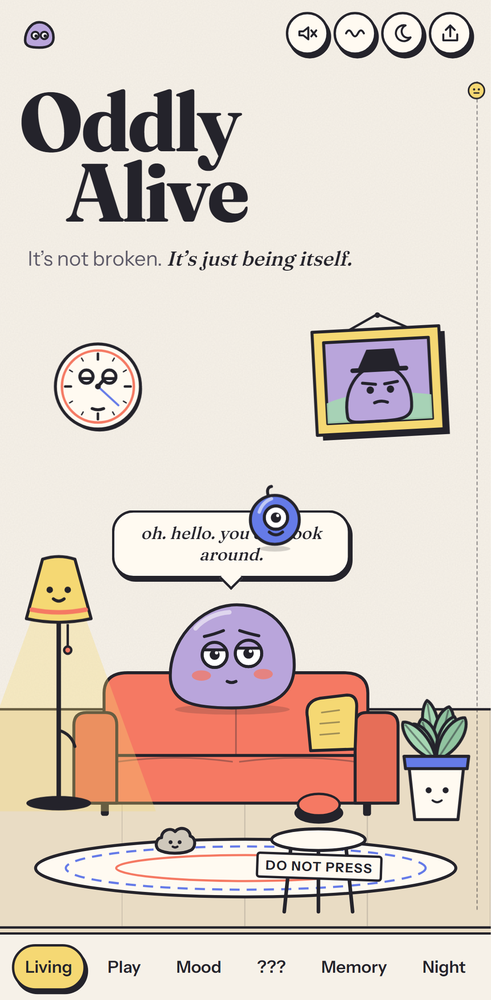
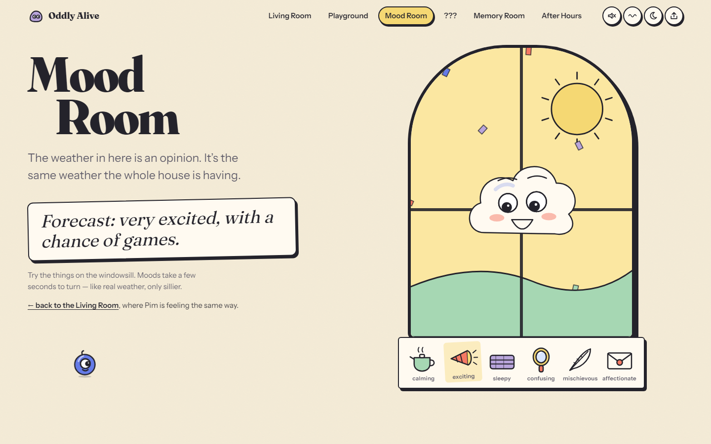
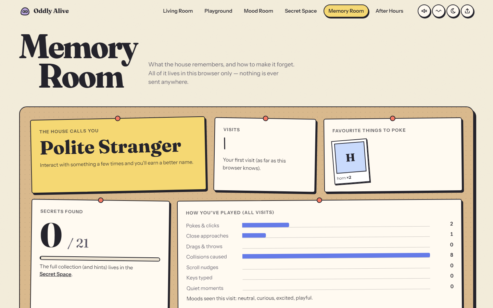
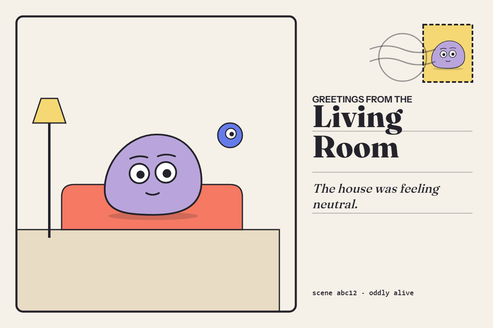

# Oddly Alive

> A website with a mind of its own. *It's not broken. It's just being itself.*


Oddly Alive is an interactive house of six rooms. The whole site behaves like
one character with moods. It notices what you do on the page and answers
through behavior:
- title letters lean away from your pointer
- a shy blob looks away if you stare
- a lamp sulks if you flick it too often
- a fern grows a leaf for every secret you find
- the weather in the Mood Room *is* the house's mood

There is no goal, score, tutorial or chatbot. The activity is the website itself.

**Live demo:** https://destegio.github.io/oddly-alive/. Every push to `main` builds it to the `gh-pages` branch; GitHub Pages has to be pointed at that branch once (see "Deployment").

## The rooms

| | |
| --- | --- |
| **Living Room**: Pim the shy blob, Dot the follower, Lumen the lamp, Tick the clock, Ferdinand the fern, a dust bunny and a do-not-press button. Scroll down for how the house works, and a creaky floorboard. |  |
| **Playground**: Matter.js shapes with faces. They have momentum, stack and collide, and the room opens with a ramp-and-domino chain reaction. |  |
| **Mood Room**: a tall window whose weather is the shared mood. Six objects on the sill (tea, a party horn, a blanket, a mirror, a feather, a kind letter) nudge the whole house. |  |
| **Secret Space**: a dark cabinet lit by a torch that follows your pointer. It shows every secret, with optional hints, plus a chest, a token puzzle and invisible ink. |  |
| **Memory Room**: everything the house remembers about this browser: visits, secrets, favourite things to poke and a silly nickname. It also has Reset Session, Reset World and Forget me. |  |
| **After Hours**: a rooftop at night with a moon that's too close, stars you can connect, a radio, and a porch light that attracts a moth. A manual night switch themes the whole house. |  |

You can share any scene as a link or as a generated postcard:



## Things to try (mild spoilers)

- Hover slowly near Pim, then stare. Then draw three circles around Pim.
- Press the button that says *do not press*. Keep going.
- Nudge Great-Aunt Pim's portrait. Then visit the Playground.
- Type `hello`, `wonk` or `dance` anywhere.
- In the Mood Room, pour tea and then unfold the blanket.
- Find something in one room, then go back to the Living Room and listen.

There are 21 secrets. None of them is required for anything.

## How it works

Every interaction goes through one typed, event-driven engine. There is no
pile of click handlers.

```
DOM input ─► typed WorldEvent ─► personality (6 bounded variables → 10 moods)
                               ─► counters / memory / discoveries (plugins)
                               ─► behavior engine: eligible behaviors → cooldowns → predicates
                                  → seeded weighted pick (recent repeats down-weighted)
                               ─► reaction scheduler: priorities, one reaction per actor,
                                  ambient cap, guaranteed cleanup/cancellation
                               ─► actor channel ─► characters (imperative, no global re-render)
```

- **125 behaviors** cover all 110 catalogue ideas
  ([`INTERACTION_CATALOG.md`](INTERACTION_CATALOG.md)). Each lists its
  trigger, preconditions, priority, cooldown and cleanup in
  `src/behaviors/*.ts`.
- **The personality is honest.** It is six numbers and explicit rules, with
  hysteresis so moods don't flicker. The site never claims to feel anything,
  and the copy says so.
- **High-frequency state stays out of React.** The pointer, springs, eyes,
  letters and physics run in one shared `requestAnimationFrame` loop. That
  loop pauses when the tab is hidden and skips work when nothing moves.
- **Determinism:** the RNG is seeded, the clock injectable and the scheduler
  testable. A shared link's seed reproduces the scene's variations.

More detail: [`ARCHITECTURE.md`](ARCHITECTURE.md), [`DECISIONS.md`](DECISIONS.md),
[`DESIGN_DIRECTION.md`](DESIGN_DIRECTION.md), [`PRODUCT_VISION.md`](PRODUCT_VISION.md).

## Privacy

- The site only observes events inside this page. There is no camera,
  microphone, history or fingerprinting.
- There are no analytics, no backend and no network calls. Fonts are
  self-hosted.
- Memory is a small, versioned record in `localStorage`:
  - visits
  - discoveries
  - per-object counts
  - a trust number
  - a few settings

  The Memory Room shows the raw data and can delete it. Memory can also be
  switched off.
- Shared links carry only the room, a scene seed, the night switch and (in
  the Playground) where the shapes are.

## Accessibility

- Every interactive prop is a real `<button>` with a label. Every behavior can
  be reached by keyboard, or has a keyboard equivalent: arrows push shapes and
  move Dot; stars connect with Enter.
- There is a skip link and a persistent nav that never animates away. Escape
  calms all effects.
- `prefers-reduced-motion` is respected and can be toggled in the nav. Nothing
  flashes; the neon sign hums slowly.
- Sound is opt-in and synthesized, with no audio files. It is never restored
  on a new visit and is suspended in hidden tabs.
- axe-core reports 0 serious or critical WCAG A/AA violations in every room,
  on desktop and mobile. See [`TESTING.md`](TESTING.md) for what that does
  and doesn't prove.

## Stack

React 18 · TypeScript (strict) · Vite · Zustand · CSS Modules · Matter.js
(Playground only, lazy-loaded) · Web Audio · Vitest + Testing Library ·
Playwright + axe-core. Fonts: Fraunces and Instrument Sans (SIL OFL), via
Fontsource.

## Run it

```bash
npm install
npm run dev          # http://localhost:5173
npm run check        # typecheck + lint + unit tests
npx playwright install chromium && npm run e2e
npm run build        # production build in dist/
```

Results of the last full run, with measured performance and known gaps, are
in [`TESTING.md`](TESTING.md).

## Deployment

`.github/workflows/deploy.yml` runs the checks, builds with
`BASE_PATH=/oddly-alive/` and publishes `dist/` to the `gh-pages` branch. The
app uses hash routing, so deep links work on static hosting with no rewrites.

One-time setup: **Settings → Pages → Build and deployment → Source: Deploy
from a branch → `gh-pages` / `(root)`**.

## Limitations

- There has been no usability testing with real people yet. The
  experience targets are hypotheses.
- Only Chromium was tested automatically.
- Mobile performance has not been measured on real devices.
- Audio levels have not been tuned by ear.

## Credits

Concept, design, characters, code and copy are original to this project.
Inspiration sites listed in the brief were not browsed or copied. Fraunces
and Instrument Sans are used under the SIL Open Font License.
