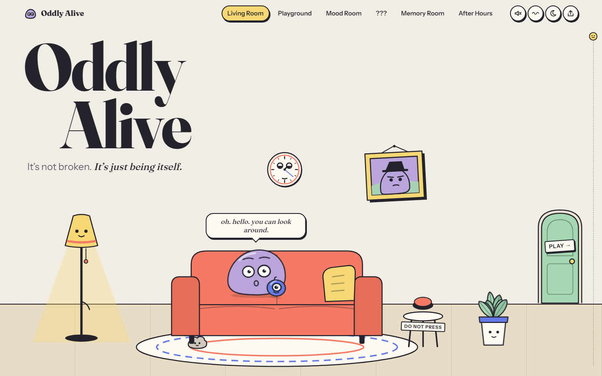
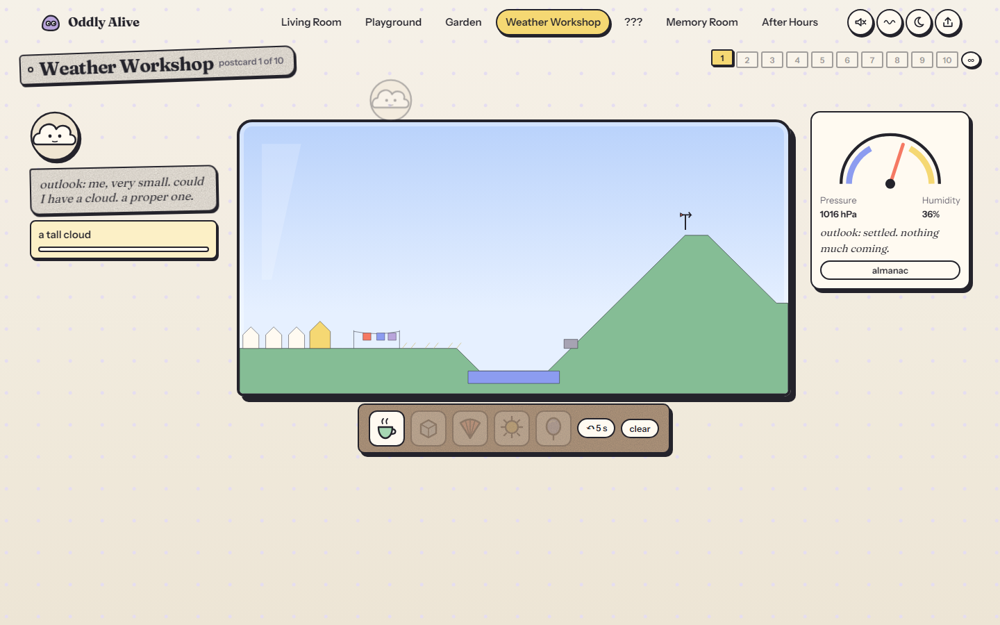
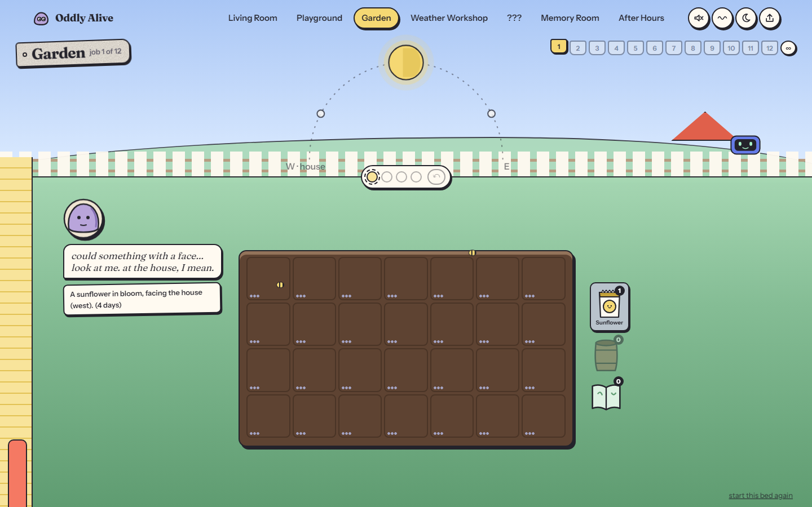
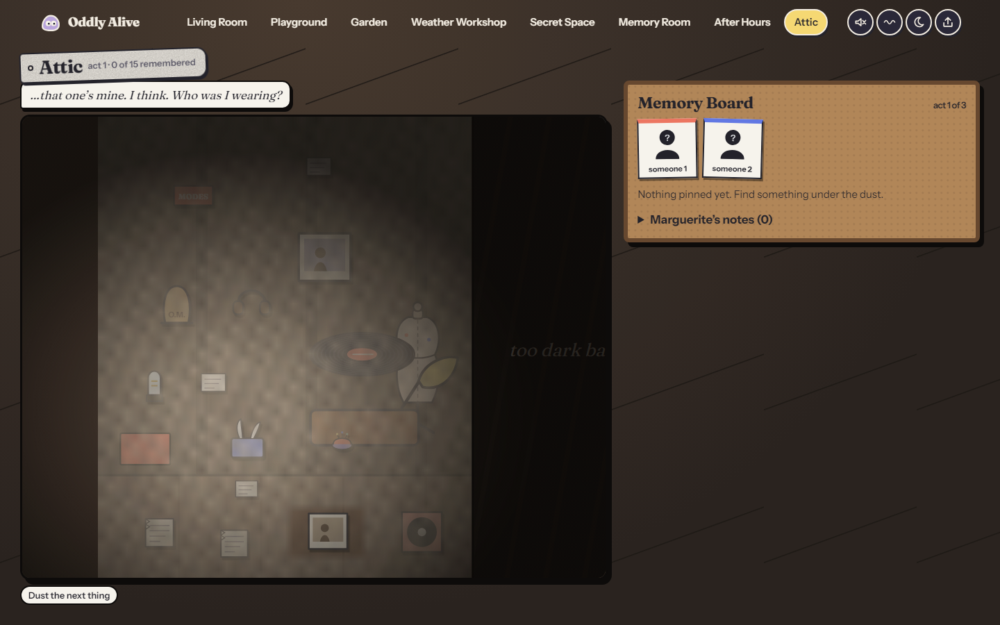
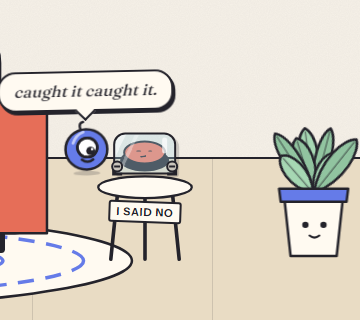
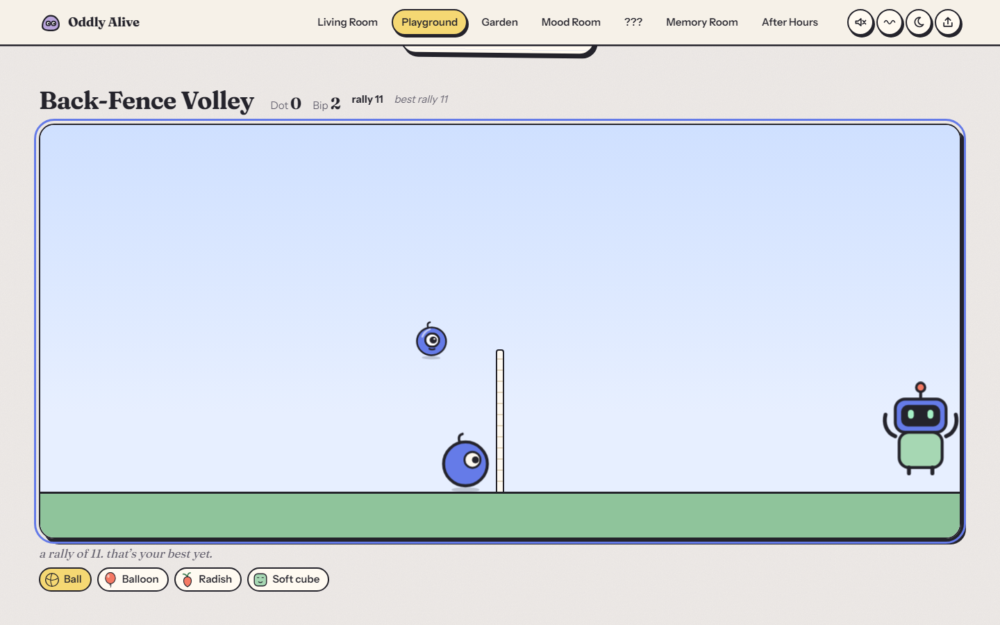
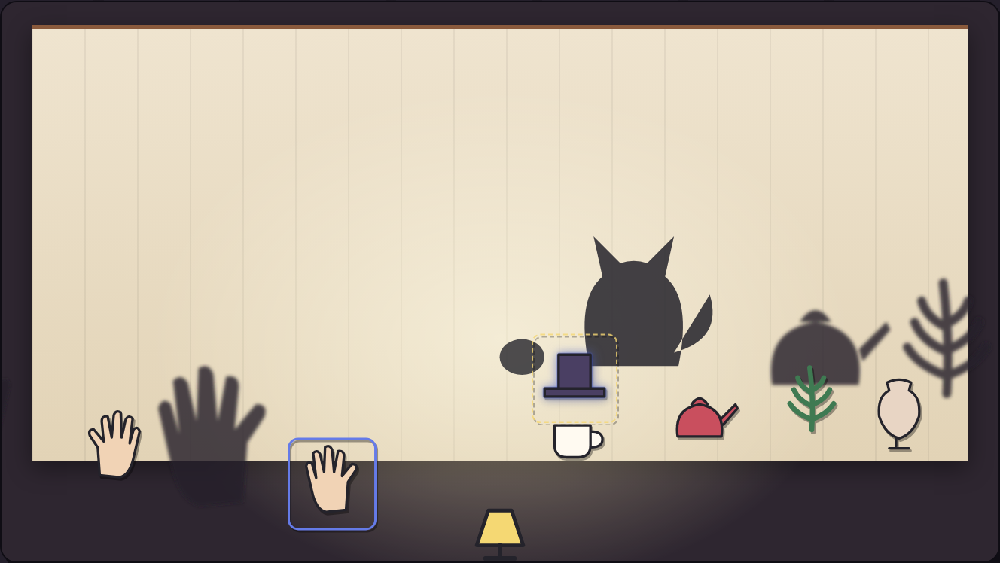

# Oddly Alive

> A website with a mind of its own. *It's not broken. It's just being itself.*



Oddly Alive is an interactive house of eight rooms. The whole site behaves like
one character with moods. It notices what you do on the page and answers
through behavior:
- title letters lean away from your pointer
- a shy blob looks away if you stare
- a lamp sulks if you flick it too often
- a fern grows a leaf for every secret you find
- the weather comes from a little valley in a glass box (the mood fills it when you don't), and every room feels it
- a robot next door plays volleyball with whatever you throw over the fence
- Great-Aunt Pim left a letter in every room

Most of the house has no goal, score, tutorial or chatbot: the activity is the website itself. Three rooms are small games with rules you discover by trying things (Phase 4): the Garden, the Weather Workshop and the Attic.

**Live demo:** https://destegio.github.io/oddly-alive/. Every push to `main` builds it to the `gh-pages` branch; GitHub Pages has to be pointed at that branch once (see "Deployment").

## The rooms

| | |
| --- | --- |
| **Living Room**: Pim the shy blob, Dot the follower, Lumen the lamp, Tick the clock, Ferdinand the fern, a dust bunny, and characters with plans of their own: Tick straightens the crooked portrait, Dot pinches the sofa cushion or Pim's teacup (put them back, or don't), Lumen stages a spotlight show. The do-not-press button has feelings: go at it and it builds a glass box over itself; lift the glass once it has calmed down, loosen its bolts, wait it out, or ask Dot. A very small painting on the wall is of this room: zoom into it for **Infinite Rooms**, a seemingly endless run of impossible living rooms, each with a way into the next. |  |
| **Playground**: Matter.js shapes with faces. They have momentum, stack and collide, and the room opens with a ramp-and-domino chain reaction. Throw something hard enough and it leaves the tray: over the fence, Bip volleys it back. Further down, **Back-Fence Volley**: you are Dot, Bip is over the fence; timing your swing shapes the shot; play with a ball, a balloon, a radish, a soft cube or (once the attic is found) a slipper. Field Notes keep score. |  |
| **Weather Workshop** (was the Mood Room): the window is a little valley in a glass box, and its weather is not chosen, it happens. Put a teacup, an ice cube, a fan, the sun lamp or the mirror into the valley, raise or lower the weathervane, wring Nimbus out: heat rises, cold wet air makes cloud, heavy cloud rains (or snows, if the ground is cold), wind blows from cold to warm, fog settles in still cold air, rainbows land opposite the lamp. Ten postcards ask for particular weather; the barometer forecasts by looking ten seconds ahead. Whatever the valley does is the whole house's weather. |  |
| **Secret Space**: a dark cabinet lit by a torch that follows your pointer. It shows every secret, with optional hints, plus a chest, a token puzzle and invisible ink. |  |
| **Memory Room**: everything the house remembers about this browser: visits, secrets, favourite things to poke and a silly nickname. It also has Reset Session, Reset World and Forget me. |  |
| **After Hours**: a rooftop at night with a moon that's too close, a radio, a porch light and a moth. The stars are an instrument: every star has a note, and a constellation plays as a tune (the stars light as they sound, so it works with the sound off). |  |
| **Garden**: a bed of plants with opinions, and you are the sun. Drag the sun along the sky and let go: a day passes, lit from where you left it (shadows are long when the sun is low). Sunflowers face the sun and throw shade, moonflowers grow in shade and open at night, mint spreads from wet soil and swallows seeds, snapdragons eat mint, radishes need company, creepers climb rock and carry water, bees cross blooms into new seeds, Crumb the sparrow takes lone seeds. Twelve jobs from the house; the day track takes you back; the Herbarium only writes down what you have made happen. |  |
| **Attic**: *What Marguerite Forgot*. Five people lived in this house across sixty years and left fifteen things in the attic. Rub the dust off to find them, and the evidence: photographs, pages from the house's old diary, record sleeves, labels, five memories in the shadow theatre. Pin each thing to the Memory Board with a person and a decade; three right at once and Marguerite remembers. Three acts, a trunk that wants a year, and a twist. |  |

Phase 3 in pictures (the button behind its glass, Infinite Rooms, Back-Fence Volley, the shadow theatre):

 
 

You can share any scene as a link or as a generated postcard:


## Things to try (mild spoilers)

- Hover slowly near Pim, then stare. Then draw three circles around Pim.
- Press the button that says *do not press*. Keep going.
- Nudge Great-Aunt Pim's portrait. Then visit the Playground.
- Type `hello`, `wonk` or `dance` anywhere.
- Find something in one room, then go back to the Living Room and listen.
- Throw a pebble hard over the fence in the Playground. Catch it when it comes back.
- Garden: plant the sunflower, then put the sun where the house is for its last day.
- Weather Workshop: put the teacup low in the valley and watch the barometer before it rains.
- Attic: rub the photograph that falls at your feet, then pin the hat block to the board.
- Rain on the valley's field fills the garden's barrel. A new flower from the garden turns up in the attic.
- In the attic, spin the record backwards.
- Look up in the Living Room once you have found a few things.
- Press the button three times, quickly. Then wait. Or don't.
- Leave the Living Room alone for a minute and watch.
- Zoom into the very small painting next to the clock. Keep going; check the clocks.
- Cross your two hands in front of the attic lamp. It's a memory.
- Join five stars after hours, with the sound on.

There are 67 secrets and eight letters. None of them is required for anything.

## How it works

Every interaction goes through one typed, event-driven engine. There is no
pile of click handlers.

```
DOM input ─► typed WorldEvent ─► personality (6 bounded variables → 10 moods)
                               ─► counters / memory / discoveries (plugins)
                               ─► behavior engine: eligible behaviors → cooldowns → predicates
                                  → seeded weighted pick (recent repeats down-weighted)
                               ─► reaction scheduler: priorities, one reaction per actor,
                                  ambient cap, guaranteed cleanup/cancellation
                               ─► actor channel ─► characters (imperative, no global re-render)
```

- **125 behaviors** cover all 110 catalogue ideas
  ([`INTERACTION_CATALOG.md`](INTERACTION_CATALOG.md)). Each lists its
  trigger, preconditions, priority, cooldown and cleanup in
  `src/behaviors/*.ts`.
- **The personality is honest.** It is six numbers and explicit rules, with
  hysteresis so moods don't flicker. The site never claims to feel anything,
  and the copy says so.
- **High-frequency state stays out of React.** The pointer, springs, eyes,
  letters and physics run in one shared `requestAnimationFrame` loop. That
  loop pauses when the tab is hidden and skips work when nothing moves.
- **Determinism:** the RNG is seeded, the clock injectable and the scheduler
  testable. A shared link's seed reproduces the scene's variations.

More detail: [`ARCHITECTURE.md`](ARCHITECTURE.md), [`DECISIONS.md`](DECISIONS.md),
[`DESIGN_DIRECTION.md`](DESIGN_DIRECTION.md), [`PRODUCT_VISION.md`](PRODUCT_VISION.md).

## Privacy

- The site only observes events inside this page. There is no camera,
  microphone, history or fingerprinting.
- There are no analytics, no backend and no network calls. Fonts are
  self-hosted.
- Memory is a small, versioned record in `localStorage`:
  - visits
  - discoveries
  - per-object counts
  - a trust number
  - a few settings
  - keepsakes: garden jobs done and Herbarium pages, postcards answered and the
    sandbox valley, the attic's Memory Board, letters found, weather seen,
    personal bests, and a short diary (40 lines at most)

  The Memory Room shows the raw data and can delete it. Memory can also be
  switched off.
- Shared links carry only the room, a scene seed, the night switch and (in
  the Playground) where the shapes are.

## Accessibility

- Every interactive prop is a real `<button>` with a label. Every behavior can
  be reached by keyboard, or has a keyboard equivalent: arrows push shapes and
  move Dot; stars connect with Enter.
- There is a skip link and a persistent nav that never animates away. Escape
  calms all effects.
- `prefers-reduced-motion` is respected and can be toggled in the nav. Nothing
  flashes; the neon sign hums slowly.
- Sound is opt-in and synthesized, with no audio files. It is never restored
  on a new visit and is suspended in hidden tabs.
- axe-core reports 0 serious or critical WCAG A/AA violations in every room,
  on desktop and mobile. See [`TESTING.md`](TESTING.md) for what that does
  and doesn't prove.

## Stack

React 18 · TypeScript (strict) · Vite · Zustand · CSS Modules · Matter.js
(Playground only, lazy-loaded) · Web Audio · Vitest + Testing Library ·
Playwright + axe-core. Fonts: Fraunces and Instrument Sans (SIL OFL), via
Fontsource.

## Run it

```bash
npm install
npm run dev          # http://localhost:5173
npm run check        # typecheck + lint + unit tests
npx playwright install chromium && npm run e2e
npm run build        # production build in dist/
```

Results of the last full run, with measured performance and known gaps, are
in [`TESTING.md`](TESTING.md).

## Deployment

`.github/workflows/deploy.yml` runs the checks, builds with
`BASE_PATH=/oddly-alive/` and publishes `dist/` to the `gh-pages` branch. The
app uses hash routing, so deep links work on static hosting with no rewrites.

One-time setup: **Settings → Pages → Build and deployment → Source: Deploy
from a branch → `gh-pages` / `(root)`**.

## Limitations

- There has been no usability testing with real people yet. The
  experience targets are hypotheses.
- Only Chromium was tested automatically.
- Mobile performance has not been measured on real devices.
- Audio levels have not been tuned by ear.

## Credits

Concept, design, characters, code and copy are original to this project.
Inspiration sites listed in the brief were not browsed or copied. Fraunces
and Instrument Sans are used under the SIL Open Font License.
